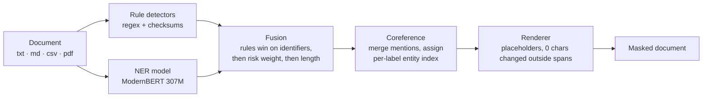

# piitier

**Polish PII anonymisation for regulated industries: fintech, insurtech, medtech.**

piitier finds and masks personal data in Polish documents: claims, policies, loan agreements, hospital
discharge letters, bank statements, call-centre transcripts. It pairs checksum-validated detectors for every
Polish state identifier with a fine-tuned NER model, and replaces only what it detects. Never a character
more.


```text
$ piitier mask zgloszenie.txt --model training/out/pii-5-v4 --threshold 0.78
Zgłoszenie szkody z dnia 12.03.2025.
Poszkodowana [IMIĘ_1] [NAZWISKO_1], zam. [ADRES_1], PESEL [PESEL],
tel. [TELEFON], e-mail [EMAIL]. Rozpoznanie: [ROZPOZNANIE].
Kwota roszczenia: [KWOTA]. Lekarz prowadzący: [LEKARZ_1].
```

> **Status: 0.1.0.** Library, CLI, TUI, training and evaluation pipeline are complete and the
> `pii-5-v4` checkpoint is published at [huggingface.co/emgiezet/piitier](https://huggingface.co/emgiezet/piitier).
> piitier is a tool, not a certificate of anonymisation; review its output before you rely on it.

## Why piitier

Polish documents come with their own structured identifiers: PESEL, NIP, REGON, dowód osobisty, KW, NPWZ,
Polish IBAN. piitier covers 39 entity types across 6 GDPR risk groups, with Art. 9 health data handled
separately.

Checksum validators catch every valid state identifier with no false negatives. A 307M-parameter encoder
(ModernBERT) handles names, addresses, amounts and health data. Where rules and model disagree on an
identifier, the rules win.

Output differs from input only inside detected spans. A property-based test pins this at exactly 0 changed
characters outside spans. No LLM rewrites your document.

Any identifier that fails its checksum is still masked and flagged as `suspect`, never dropped. A threshold
is accepted only if it leaks nothing on the hand-written benchmark.

Inference runs on CPU with no network calls and no telemetry. Rules-only mode needs no model at all.

The code is Apache-2.0; the synthetic corpus and benchmark are CC BY 4.0. Every reported number is
traceable to a report in `eval/reports/`.

## Install

**From PyPI** (no git clone required):

```bash
pip install piitier              # rules-only masking; no torch dependency
pip install 'piitier[ner]'       # adds torch + transformers for the NER model
pip install 'piitier[onnx]'      # adds ONNX runtime inference instead of PyTorch
```

**From source** (development):

```bash
git clone https://github.com/emgiezet/piitier && cd piitier
uv sync            # runtime + dev dependencies (torch/transformers for the NER model)
```

Rules-only masking (`piitier mask` without `--model`) needs only the base package; importing
`piitier` never loads torch.

### Download the model

The published model is available on Hugging Face:
**[emgiezet/piitier](https://huggingface.co/emgiezet/piitier)**.

Pass `--model emgiezet/piitier` to `mask`, `mask-batch` or `compare` to download and
cache it automatically, without preparing a local checkpoint directory first.

## Quick start

### Command line

```bash
piitier --version
uv run piitier mask document.pdf                                        # rules only; .txt .md .csv .json .pdf (text layer)
uv run piitier mask document.pdf -o out.txt --model <checkpoint-dir> --threshold 0.78
uv run piitier mask document.pdf --model emgiezet/piitier --revision <sha> --threshold 0.78  # Hub repo id
uv run piitier mask customers.csv --skip-columns "ID,2"                 # keep columns by header name or 1-based index
uv run piitier mask customers.csv --skip-columns "ID" --delimiter ";"   # override delimiter auto-detection
uv run piitier compare claims.csv --model <checkpoint-dir> --device cuda  # interactive TUI: pick columns, mask, export
uv run piitier compare claims.csv --model emgiezet/piitier --revision <sha>  # Hub repo id form
uv run piitier scan src/ docs/                                          # list checksum-valid identifiers, never their values
uv run piitier scan src/ --write-allowlist .pii-allowlist               # write all fingerprints and exit 0
```

- `mask` writes the masked document. Exit 0 on success; exit 2 on a usage or input error (missing
  file, unsupported type, invalid threshold, model download failure); exit 3 when the input PDF has
  no text layer. Error messages name the path, never the document content.
- `compare` opens a side-by-side terminal view. For CSV it shows a table preview with per-column
  checkboxes (all masked by default), then lets you export next to the source without overwriting
  existing files. `--model` accepts a local directory or a Hugging Face Hub repo id; `--revision`
  pins a Hub branch, tag, or commit hash.
- `scan` prints `path:line:column: LABEL` for every checksum-valid identifier. Exit 0 when nothing
  outside the allowlist is found; exit 1 when unallowlisted identifiers are present; exit 2 on a
  missing path or missing allowlist file. `--write-allowlist <file>` writes fingerprints of all
  findings (merged with any existing allowlist) and exits 0 without printing findings. Run as a
  pre-commit hook to gate your own repository.

### JSON documents

`mask`, `mask-batch` and `compare` accept `.json` files (case-insensitive):

```bash
uv run piitier mask record.json -o masked.json
uv run piitier mask record.json -o masked.json --model <checkpoint-dir> --threshold 0.78
uv run piitier compare record.json --model <checkpoint-dir>
```

Only **string values** are anonymised, including nested object/array values and a
top-level string. Detection sees decoded characters, so Unicode-escaped identifiers
are masked too. Keys, numbers, booleans and null remain unchanged: identifiers stored
as JSON numbers or object keys are **not anonymised**. Store sensitive identifiers in
string values when using this mode.

Replacements are applied to the original serialization, not to a re-encoded object.
Whitespace, CRLF, key order, duplicate keys, numeric spelling and escapes outside
replacements remain intact. Model-backed entity numbering is shared across values
within one document and resets for the next document. `compare` uses the existing
before/after panes and navigation; CSV-specific column selection/export is unchanged.

Input must be one valid UTF-8 JSON document; an optional leading UTF-8 BOM is retained.
Malformed JSON, invalid UTF-8 and non-JSON constants such as `NaN`/`Infinity` fail safely,
without echoing input. Single-file failures exit 2 before model loading or output
creation; batch failures affect only that file. JSONL, comments, field selectors and
machine-readable detection reports are not part of this input mode.

### Password-protected PDFs

`mask` accepts RC4, AES-128 and AES-256 PDFs with a user or owner password. Without a
credential it first tries the empty password, then offers up to three hidden attempts
when stdin and stderr are terminals:

```bash
uv run piitier mask locked.pdf -o masked.txt
uv run piitier mask locked.pdf --password-stdin -o masked.txt
```

`--password-stdin` reads one line, removing only its LF/CRLF terminator. A blank line is
an empty password; EOF is an input error. It never prompts. `--password VALUE` is also
available, but exposes the argument in process listings and shell history. The options
are mutually exclusive and PDF-only. No passwords or decrypted intermediate PDFs are
saved. Missing/wrong credentials exit 2 without creating or truncating the output;
authenticated PDFs without a text layer exit 3. EOF cancels entry; Ctrl-C exits 130.

Output is masked extracted text, not a redacted or encrypted PDF. Scanned PDFs still
require a text layer; this workflow does not perform OCR.

`compare locked.pdf --model <checkpoint-dir>` opens a masked password dialog before
loading the model or showing the existing comparison panes. Enter/Unlock submits the
exact value (including empty); Escape/Cancel exits 2. It requires terminal stdin and
stdout for credential entry, permits three attempts, and retains no password history.
If authentication is required without both terminals, `compare` exits 2 without
opening a dialog or loading the model.

### Directory batches

```bash
uv run piitier mask-batch ./inputs -o ./masked --passwords ./inputs/passwords.csv
uv run piitier mask-batch ./inputs -o ./masked --model <checkpoint-dir> --threshold 0.78
```

`--passwords` is optional. Its CSV must be UTF-8 (optional BOM) with exactly the header
`filename,password` or `filename;password`. Filenames are case-sensitive basenames,
not paths, and cannot repeat. Standard CSV quoting preserves punctuation, whitespace,
embedded newlines and empty passwords. Blank records are ignored; a header-only map
is valid. Invalid records fail before processing and report only the map path/line.
Treat the mapping as a secret file; never commit it.

Batch processes supported regular files once in filename order, without recursion.
The mapping file and its resolved aliases are excluded, even inside inputs.
Text and JSON filenames are retained; PDFs become `.txt`. Outputs must be outside the input
directory, and existing files/symlinks or earlier colliding outputs are never overwritten.
Each output is created only after extraction and masking succeed.

Model options match `mask`, including `--revision`; one model instance is reused while
numbering stays document-local. CSV inputs are masked as whole documents (no column
selection in batch). Missing/wrong passwords can be corrected through hidden terminal
entry; EOF fails only that file. Other per-file failures also allow later files to run.
Ctrl-C exits 130, preserves completed outputs and removes the active partial write.
Stdout remains empty. Stderr ends with `batch: N masked, M failed`; exit 0 means all
selected files succeeded (including empty selection), 4 means per-file failures, and 2
means invalid configuration or initial model failure.

### Python

```python
import piitier

text = "Poszkodowana Anna Wiśniewska, PESEL 44051401359."

piitier.mask(text)
# -> 'Poszkodowana Anna Wiśniewska, PESEL [PESEL].'

piitier.detect(text)
# -> [Span(start=36, end=47, label=<Label.PESEL: '[PESEL]'>, source='rule', score=1.0, status='valid')]

anon = piitier.Anonymizer(model="training/out/pii-5-v4", threshold=0.78)  # local directory
anon.mask(text)
# -> 'Poszkodowana [IMIĘ_1] [NAZWISKO_1], PESEL [PESEL].'

hub_anon = piitier.Anonymizer(
    model="emgiezet/piitier",  # Hugging Face Hub repo id; requires piitier[ner]
    revision="main",  # branch, tag, or commit hash
    threshold=0.78,
)
hub_anon.mask(text)
# -> 'Poszkodowana [IMIĘ_1] [NAZWISKO_1], PESEL [PESEL].'

piitier.mask_csv(csv_text, skip_columns=["ID"], delimiter=";")  # column-aware CSV masking
```

`Anonymizer` also accepts `predictor=` (any object with `predict(text) -> list[Span]`), so you can plug in
your own model behind the same rules and fusion layer.

## How it works



After fusion, a coreference stage walks the spans in document order and assigns a numeric
index to each entity. Labels marked `numbered` in the taxonomy (OSOBA, IMIE, NAZWISKO,
ADRES, LEKARZ) get indexed placeholders: the first distinct entity encountered for a label
becomes `_1`, the next new entity `_2`, and so on. Mention matching uses Morfeusz 2 lemmas
for names and case-folded collapsed text for addresses; a lone surname or initial+surname
is merged into an earlier entity of the same label only when exactly one candidate matches.
Labels without `numbered` (PESEL, IBAN, etc.) are passed through unchanged.


Four invariants the code is built around (`CLAUDE.md`):

1. **Text fidelity**: output differs from input only inside `[start, end)` spans.
2. **Recall first**: checksum failures are `suspect`, still masked.
3. **No generative output**: models only propose spans.
4. **Rules win on identifiers**: a checksum-valid PESEL, NIP, REGON, IBAN, ID-card or card number beats any
   overlapping model span.

### What it detects

| Risk group | Weight | Entities | Method |
|---|---|---|---|
| State identifiers | 1.0 | PESEL, ID card, passport, driving licence, NIP, REGON | rules + checksums |
| Finance | 1.0 | IBAN (mod-97), account number, payment card (Luhn), CVV, contract number, amount, income | rules + NER |
| Insurance | 0.9 | policy number, claim number, vehicle registration, VIN, land-register (KW) number | configurable patterns + rules + NER |
| Contact & location | 0.8 | address, postcode, city, phone, e-mail, IP, geo | rules + NER |
| Health (GDPR Art. 9) | 0.8 | health data, diagnosis, ICD-10, medication, record number, facility, physician, NPWZ | NER + dictionaries + rules |
| Person identity | 0.6 | full name, first name, surname, date of birth, age, sex | NER |

[`docs/TAXONOMY.md`](docs/TAXONOMY.md) is the single source of truth for labels, placeholders and weights; a
test keeps it in sync with the `Label` enum.

## The model

| Release candidate | `pii-5-v4`, calibrated threshold **0.78** ([`training/configs/pii-5-v4.yaml`](training/configs/pii-5-v4.yaml)) |
| Model card | [`training/model_cards/pii-5-v4/README.md`](training/model_cards/pii-5-v4/README.md) |
| Hub repo | [`emgiezet/piitier`](https://huggingface.co/emgiezet/piitier): safetensors, FP32 ONNX, INT8 ONNX, model card (commit `04e50590`) |
| Base | [`bardsai/eu-pii-anonimization-multilang-v2`](https://huggingface.co/bardsai/eu-pii-anonimization-multilang-v2) — ModernBERT, 307M parameters, Apache-2.0 |
| Training data | synthetic Polish corpus, 9 document types, see [`docs/DATASET_CARD.md`](docs/DATASET_CARD.md) |
| Formats | PyTorch safetensors, FP32 ONNX and dynamic INT8 ONNX. The INT8 export passes the recall gate for `pii-5-v4` (recall 0.9814 vs 0.9868 FP32 on synthetic dev, delta 0.0054 < 0.01); it had failed for `pii-5-v3` (delta 0.018) |
| Hardware | trains in hours on a single consumer GPU; CPU inference |

### Results

Synthetic calibration split, 1 031 documents, 14 766 gold spans, strict span matching:

| Metric | pii-5-v4 @ 0.78 |
|---|---|
| Strict recall | **0.987** (Wilson 95 % CI 0.985–0.988) |
| Precision | **0.971** |
| Leaked PII values | **0** — no gold value appears verbatim in the masked output |

Hand-written PL-PII-Bench `v1/dev`, 6 documents, 40 gold spans, one per document type:

| System | Leaked PII values | Strict F1 |
|---|---|---|
| **piitier pii-5-v4** | **0 / 40** | 0.69 |
| piitier pii-5-v3 | 0 / 40 | 0.65 |
| base model (bardsai v2) | 2 / 40 | 0.31 |

Full reports: [`eval/reports/pii-5-v4/`](eval/reports/pii-5-v4/),
[`eval/reports/2026-10-25-training-pii-5.md`](eval/reports/2026-10-25-training-pii-5.md),
and the running log in [`FINDINGS.md`](FINDINGS.md).

Honest footnote: `bench/v1/dev` is small and was also used as the privacy gate when choosing the threshold,
so its 0/40 is a safety check, not independent proof of generalisation. The frozen `bench/v1/test` split
(300–500 double-annotated documents) is the next milestone.

## PL-PII-Bench

piitier ships the first open benchmark for PII detection in Polish regulated-sector documents:

- versioned gold set under [`bench/`](bench/) with a frozen `test/` split that is never used for training,
  calibration or prompt examples (the config loader rejects it);
- [annotation guidelines](docs/labelling/GUIDELINES.md) and an [evaluation protocol](docs/bench/PROTOCOL.md)
  defining strict/partial P/R/F1 per label, risk-weighted recall, leak rate, fidelity, numbering consistency
  and throughput;
- baseline adapters in [`eval/baselines/`](eval/baselines/) for `rules`, `ner`, Microsoft Presidio,
  `bardsai-v2` and `openai/privacy-filter`, so every system is scored by the same code.

```bash
uv run python -m eval.run --system ner --checkpoint training/out/pii-5-v4 --bench v1 --split dev
uv run python -m eval.compare <baseline-report.json> <candidate-report.json>   # exits 1 on recall regression
```

## Train your own

The whole pipeline is config-driven; a YAML file is the only input.

```bash
uv run python -m piitier.datagen build --templates src/piitier/datagen/templates --n 20000 --seed 42 --out data/synthetic/<version>/
uv run python -m piitier.datagen check data/synthetic/<version>/

uv run python -m training.train       training/configs/<run>.yaml   # HF Trainer + seqeval
uv run python -m training.calibrate   training/configs/<run>.yaml   # recall-first, privacy-gated threshold
uv run python -m training.export_onnx training/configs/<run>.yaml   # FP32 + INT8 ONNX; blocks on recall drop
```

`training.train` pins a single GPU when several are visible. See [`docs/PLAN.md`](docs/PLAN.md) for the
design rationale and roadmap.

## Data and privacy policy

- Only synthetic documents enter the repository. Employer or client documents never do.
- Templates derived from internal documents stay local and gitignored; a clean clone builds its corpus from
  the hand-written templates only.
- Every checksum-valid identifier committed to the repository must be allowlisted by fingerprint in
  `.pii-allowlist`; the `piitier scan` pre-commit hook and CI enforce it. Only synthetic values qualify.
- The synthetic corpus and the benchmark are released under CC BY 4.0.

## Roadmap

| Milestone | Status |
|---|---|
| Rules + NER + fusion + renderer, CLI, TUI, CSV column control | done |
| Privacy-gated calibration (`pii-5-v4`, threshold 0.78) | done |
| Load models by Hub id (`--model owner/name`, `--revision`) | done |
| Publish `pii-5-v4` on the Hugging Face Hub with a model card | done, 2026-10-28 |
| Frozen `bench/v1/test` split, 300–500 double-annotated documents | planned |
| Numbered coreference placeholders (`[OSOBA_1]`, `[OSOBA_2]`) | done |
| Reversible `pseudonymize` mode with an encrypted mapping | planned |
| INT8 ONNX once the recall gate passes | done for `pii-5-v4` (delta 0.0054) |

## Known limitations

- Pronoun coreference ("ona", "jego") is not resolved; pronouns are not masked.
- A lone surname or initial+surname with two or more plausible candidates receives a new index rather than being merged.
- Coreference is per-document only; numbered indices are not consistent across separate `mask` calls.
- `bench/v1` has 6 documents; the `test/` split does not exist yet.
- `pip install piitier` without extras gives rules-only masking; NER requires `pip install 'piitier[ner]'`.
- Quasi-identifiers (job title, employer, event dates) and colloquial health descriptions are outside the
  current taxonomy; see the roadmap section of `docs/TAXONOMY.md`.
- `uv.lock` is excluded from `piitier scan` because NIP/PESEL/REGON rules fire on package hashes; synthetic
  values inside the lock file are not vetted.

## Repository layout

| Path | Contents |
|---|---|
| `src/piitier/` | library: `rules/` (checksum validators), `ner/` (inference), `fusion.py`, `render.py`, `loaders.py`, `csvskip.py`, `jsonmask.py`, `cli.py`, `tui.py`, `datagen/` |
| `training/` | fine-tuning, calibration and ONNX export, driven by `training/configs/*.yaml` |
| `training/model_cards/` | model cards for each released checkpoint |
| `eval/` | metrics, baseline adapters, benchmark runner and reports |
| `bench/` | PL-PII-Bench gold set (versioned) |
| `docs/` | `PLAN.md`, `TAXONOMY.md`, `DATASET_CARD.md`, `bench/PROTOCOL.md`, `labelling/GUIDELINES.md` |
| `specs/` | one directory per ticket: `spec.md` with UC acceptance criteria, QA and PR records |

## Contributing

```bash
uv sync --frozen
uv run pre-commit install --hook-type pre-commit --hook-type pre-push
uv run pre-commit run --all-files          # gitleaks, private keys, ruff, mypy, piitier scan
uv run pytest -q -m "not integration"      # unit tests, no network
uv run pytest -q -m integration            # downloads checkpoints from the Hugging Face Hub
```

CI runs the hooks, unit tests, and a wheel build (install + smoke test) on every pull request and push to
`main` and `release/**`; integration tests run weekly and on demand via `.github/workflows/integration.yml`.
Work is specced first: every change has a `specs/<TICKET>/spec.md` whose `UC-<n>` ids appear in test names.
See [`CONTRIBUTING.md`](CONTRIBUTING.md) and [`CLAUDE.md`](CLAUDE.md).

## License

Code: Apache-2.0, see [`LICENSE`](LICENSE) and [`NOTICE`](NOTICE). Base model: Apache-2.0 (bards.ai).
Synthetic corpus and benchmark: CC BY 4.0.
