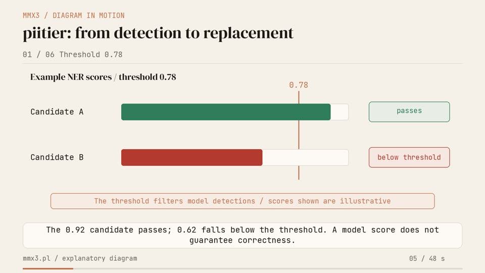
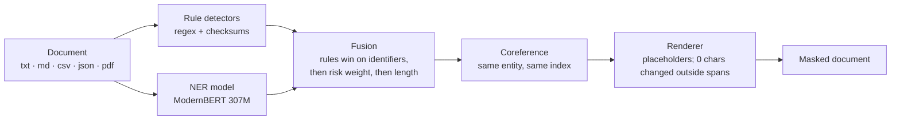

<h1 align="center">piitier</h1>

<p align="center"><strong>Polish PII anonymisation for regulated industries. Fintech, insurtech, medtech.</strong></p>

<p align="center">
<a href="https://github.com/emgiezet/piitier/actions/workflows/ci.yml"></a>
<a href="https://pypi.org/project/piitier/"></a>
<a href="https://pypi.org/project/piitier/"></a>
<a href="https://pypistats.org/packages/piitier"></a>
<a href="https://github.com/emgiezet/piitier/releases/latest"></a>
<a href="LICENSE"></a>
<br>
<a href="https://huggingface.co/emgiezet/piitier"></a>
<a href="https://huggingface.co/bardsai/eu-pii-anonimization-multilang-v2"></a>
<a href="docs/TAXONOMY.md"></a>
<a href="docs/DATASET_CARD.md"></a>
<a href="https://github.com/astral-sh/ruff"></a>
<a href="pyproject.toml"></a>
</p>

piitier finds and masks personal data in Polish documents: insurance claims, policies, loan agreements,
hospital discharge letters, bank statements, call-centre transcripts. Checksum-validated detectors cover
every Polish state identifier; a fine-tuned NER model covers everything the checksums cannot. The renderer
replaces exactly what was detected and nothing else.

```text
$ piitier mask zgloszenie.txt --model emgiezet/piitier --threshold 0.78
Zgłoszenie szkody z dnia 12.03.2025.
Poszkodowana [IMIĘ_1] [NAZWISKO_1], zam. [ADRES_1], PESEL [PESEL],
tel. [TELEFON], e-mail [EMAIL]. Rozpoznanie: [ROZPOZNANIE].
Kwota roszczenia: [KWOTA]. Lekarz prowadzący: [LEKARZ_1].
```

<p align="center">
<a href="https://github.com/emgiezet/piitier/raw/main/docs/media/piitier-prog-fuzja-renderer-en.mp4">

</a><br>
<sub>48 s explainer: from model scores to a masked document (<a href="https://github.com/emgiezet/piitier/raw/main/docs/media/piitier-prog-fuzja-renderer-en.mp4">mp4</a>, <a href="https://github.com/emgiezet/piitier/raw/main/docs/media/piitier-prog-fuzja-renderer.mp4">Polish version</a>)</sub>
</p>

> **0.1.1 is out.** `pip install piitier`, model `pii-5-v4` on the
> [Hub](https://huggingface.co/emgiezet/piitier), 1 100+ tests, wheel smoke-tested in CI.
> piitier is a tool, not a certificate of anonymisation. Review its output before you rely on it.

## Why teams pick it

| | |
|---|---|
| **Built for Polish, not translated to it** | PESEL, NIP, REGON, dowód osobisty, KW, NPWZ, Polish IBAN, inflected names (`Jana Nowaka` is the same person as `Jan Nowak`). 39 entity types in 6 GDPR risk groups; Art. 9 health data has its own group. |
| **Zero collateral damage** | Output differs from input only inside detected spans. A property-based test pins it at exactly 0 changed characters outside spans. Formatting, whitespace, JSON structure and CSV layout survive. |
| **Recall first** | A number that fails its checksum is still masked and flagged `suspect`, never dropped. The model threshold is accepted only if it leaks nothing on the hand-written benchmark. |
| **No LLM in the loop** | Models only propose spans; code decides. Nothing gets paraphrased, hallucinated or quietly reworded. |
| **Runs where the data is** | CPU inference, no network calls, no telemetry. Rules-only mode needs no model at all. ONNX INT8 export for the thin deployments. |
| **Measured in the open** | Ships PL-PII-Bench, an annotation protocol and baseline adapters for Presidio, bards.ai and OpenAI Privacy Filter. Every number in this README links to a report in `eval/reports/`. |

## Install

```bash
pip install piitier              # rules only, no torch
pip install 'piitier[ner]'       # + torch, transformers: the NER model
pip install 'piitier[onnx]'      # + ONNX Runtime instead of PyTorch
```

Python 3.12+. From source: `git clone https://github.com/emgiezet/piitier && cd piitier && uv sync`.
Development and primary CI use CPython 3.14 (`.python-version`), with a blocking unit suite on 3.12.
Python.org lists 3.15.2, but the locked `onnxruntime==1.31.0` has no cp315 wheel or sdist, so CI only
smoke-tests the rules-only runtime on 3.15.

## 60-second tour

```bash
piitier mask claim.pdf                                        # rules only: .txt .md .csv .json .pdf
piitier mask claim.pdf --model emgiezet/piitier --threshold 0.78   # downloads and caches the model
piitier mask customers.csv --skip-columns "ID,2"              # keep columns by header or index
piitier mask-batch ./inbox -o ./masked --model emgiezet/piitier    # whole directory, one model load
piitier compare claim.pdf --model emgiezet/piitier            # side-by-side TUI, export when happy
piitier scan src/ docs/                                       # pre-commit guard: finds live identifiers in your repo
```

```python
import piitier

text = "Poszkodowana Anna Wiśniewska, PESEL 44051401359."

piitier.mask(text)  # rules only; importing piitier never loads torch
# 'Poszkodowana Anna Wiśniewska, PESEL [PESEL].'

anon = piitier.Anonymizer(model="emgiezet/piitier", threshold=0.78)  # loaded once
anon.mask(text)
# 'Poszkodowana [IMIĘ_1] [NAZWISKO_1], PESEL [PESEL].'

piitier.detect(text)  # spans with label, source, score, status
piitier.mask_csv(csv_text, skip_columns=["ID"], delimiter=";")
```

Password-protected PDFs, JSON documents, batch password maps, exit codes and the `--revision` pin are in
[`docs/CLI.md`](docs/CLI.md). `Anonymizer(predictor=...)` accepts any object with
`predict(text) -> list[Span]`, so your own model can sit behind the same rules and fusion layer.

## How it works



Four invariants the code is built around:

1. **Text fidelity.** Output differs from input only inside `[start, end)` spans.
2. **Recall first.** Checksum failures are `suspect` and still masked.
3. **No generative output.** Models propose spans; they never write text.
4. **Rules win on identifiers.** A checksum-valid PESEL, NIP, REGON, IBAN, ID-card or card number beats any
   overlapping model span.

Coreference runs after fusion: labels marked `numbered` in the taxonomy (OSOBA, IMIE, NAZWISKO, ADRES,
LEKARZ) get a per-document index, so the first person is `[OSOBA_1]` wherever they appear, inflected or
not. Mention matching uses Morfeusz 2 lemmas for names and case-folded collapsed text for addresses.

### What it detects

| Risk group | Weight | Entities | Method |
|---|---|---|---|
| State identifiers | 1.0 | PESEL, ID card, passport, driving licence, NIP, REGON | rules + checksums |
| Finance | 1.0 | IBAN (mod-97), account number, payment card (Luhn), CVV, contract number, amount, income | rules + NER |
| Insurance | 0.9 | policy number, claim number, vehicle registration, VIN, land-register (KW) number | configurable patterns + rules + NER |
| Contact & location | 0.8 | address, postcode, city, phone, e-mail, IP, geo | rules + NER |
| Health (GDPR Art. 9) | 0.8 | health data, diagnosis, ICD-10, medication, record number, facility, physician, NPWZ | NER + dictionaries + rules |
| Person identity | 0.6 | full name, first name, surname, date of birth, age, sex | NER |

[`docs/TAXONOMY.md`](docs/TAXONOMY.md) is the single source of truth for labels, placeholders and weights; a
test keeps it in sync with the `Label` enum.

## The model

| | |
|---|---|
| Checkpoint | `pii-5-v4`, calibrated threshold **0.78** ([config](training/configs/pii-5-v4.yaml), [model card](training/model_cards/pii-5-v4/README.md)) |
| Hub | [`emgiezet/piitier`](https://huggingface.co/emgiezet/piitier): safetensors, FP32 ONNX, INT8 ONNX |
| Base | [`bardsai/eu-pii-anonimization-multilang-v2`](https://huggingface.co/bardsai/eu-pii-anonimization-multilang-v2), ModernBERT, 307M parameters, Apache-2.0 |
| Training data | synthetic Polish corpus, 9 document types ([dataset card](docs/DATASET_CARD.md)) |
| INT8 | passes the recall gate: 0.9814 vs 0.9868 FP32 on synthetic dev, delta 0.0054 < 0.01 |
| Hardware | trains in hours on one consumer GPU; CPU inference |

### Results

Synthetic calibration split, 1 031 documents, 14 766 gold spans, strict span matching:

| Metric | pii-5-v4 @ 0.78 |
|---|---|
| Strict recall | **0.987** (Wilson 95 % CI 0.985–0.988) |
| Precision | **0.971** |
| Leaked PII values | **0**: no gold value appears verbatim in the masked output |

Hand-written PL-PII-Bench `v1/dev`, 6 documents, 40 gold spans, one per document type:

| System | Leaked PII values | Strict F1 |
|---|---|---|
| **piitier pii-5-v4** | **0 / 40** | **0.69** |
| piitier pii-5-v3 | 0 / 40 | 0.65 |
| base model (bardsai v2) | 2 / 40 | 0.31 |

Reports: [`eval/reports/pii-5-v4/`](eval/reports/pii-5-v4/),
[training post-mortem](eval/reports/2026-10-25-training-pii-5.md), running log in [`FINDINGS.md`](FINDINGS.md).

The small print, because it matters: `bench/v1/dev` is six documents and it doubled as the privacy gate when
the threshold was chosen. Its 0/40 is a safety check, not independent proof of generalisation. The frozen
`bench/v1/test` split (300–500 double-annotated documents) is the next milestone.

## PL-PII-Bench

The first open benchmark for PII detection in Polish regulated-sector documents:

- a versioned gold set under [`bench/`](bench/) with a frozen `test/` split that is never used for training,
  calibration or prompt examples (the config loader rejects it);
- [annotation guidelines](docs/labelling/GUIDELINES.md) and an [evaluation protocol](docs/bench/PROTOCOL.md):
  strict and partial P/R/F1 per label, risk-weighted recall, leak rate, fidelity, numbering consistency,
  throughput;
- baseline adapters in [`eval/baselines/`](eval/baselines/) for `rules`, `ner`, Microsoft Presidio,
  `bardsai-v2` and `openai/privacy-filter`, so every system is scored by the same code.

```bash
uv run python -m eval.run --system ner --checkpoint training/out/pii-5-v4 --bench v1 --split dev
uv run python -m eval.compare baseline.json candidate.json      # exits 1 on recall regression
```

## Train your own

A YAML file is the only input to the whole pipeline.

```bash
uv run python -m piitier.datagen build --templates src/piitier/datagen/templates --n 20000 --seed 42 --out data/synthetic/<version>/
uv run python -m piitier.datagen check data/synthetic/<version>/

uv run python -m training.train       training/configs/<run>.yaml   # HF Trainer + seqeval
uv run python -m training.calibrate   training/configs/<run>.yaml   # recall-first, privacy-gated threshold
uv run python -m training.export_onnx training/configs/<run>.yaml   # FP32 + INT8 ONNX; blocks on recall drop
```

Design rationale and roadmap: [`docs/PLAN.md`](docs/PLAN.md).

## Data and privacy policy

- Only synthetic documents enter the repository. Employer or client documents never do.
- Templates derived from internal documents stay local and gitignored; a clean clone builds its corpus from
  the hand-written templates only.
- Every checksum-valid identifier committed to the repository must be allowlisted by fingerprint in
  `.pii-allowlist`; the `piitier scan` pre-commit hook and CI enforce it. Only synthetic values qualify.
- Synthetic corpus and benchmark: CC BY 4.0.

## Roadmap

| Milestone | Status |
|---|---|
| Rules + NER + fusion + renderer, CLI, TUI, CSV column control | done |
| Privacy-gated calibration (`pii-5-v4`, threshold 0.78) | done |
| Models by Hub id (`--model owner/name`, `--revision`) | done |
| `pii-5-v4` on the Hugging Face Hub with a model card | done |
| Numbered coreference placeholders (`[OSOBA_1]`, `[OSOBA_2]`) | done |
| INT8 ONNX through the recall gate | done (delta 0.0054) |
| PyPI package | 0.1.1 |
| Frozen `bench/v1/test`, 300–500 double-annotated documents | planned |
| Reversible `pseudonymize` mode with an encrypted mapping | planned |
| XLSX workbooks | in review |

## Known limitations

- Pronouns ("ona", "jego") are not resolved or masked.
- A lone surname with two or more plausible antecedents gets a new index instead of being merged.
- Indices are per document; they do not persist across separate `mask` calls.
- `bench/v1` has 6 documents; the `test/` split does not exist yet.
- Quasi-identifiers (job title, employer, event dates) and colloquial health descriptions are outside the
  current taxonomy; see the roadmap section of `docs/TAXONOMY.md`.
- `uv.lock` is excluded from `piitier scan` because NIP/PESEL/REGON rules fire on package hashes.

## Repository layout

| Path | Contents |
|---|---|
| `src/piitier/` | library: `rules/` (checksum validators), `ner/` (inference, Hub resolution), `fusion.py`, `coref.py`, `render.py`, `loaders.py`, `csvskip.py`, `jsonmask.py`, `batch.py`, `cli.py`, `tui.py`, `datagen/` |
| `training/` | fine-tuning, calibration and ONNX export, driven by `training/configs/*.yaml`; `model_cards/` per released checkpoint |
| `eval/` | metrics, baseline adapters, benchmark runner and reports |
| `bench/` | PL-PII-Bench gold set (versioned) |
| `docs/` | `CLI.md`, `PLAN.md`, `TAXONOMY.md`, `DATASET_CARD.md`, `bench/PROTOCOL.md`, `labelling/GUIDELINES.md` |
| `specs/` | one directory per ticket: `spec.md` with UC acceptance criteria, QA and PR records |

## Contributing

```bash
uv sync --frozen
uv run pre-commit install --hook-type pre-commit --hook-type pre-push
uv run pre-commit run --all-files          # gitleaks, private keys, ruff, mypy, piitier scan
uv run pytest -q -m "not integration"      # unit tests, no network
uv run pytest -q -m integration            # downloads checkpoints from the Hugging Face Hub
```

CI runs the hooks, unit tests and a wheel build with an install smoke test on every pull request and push to
`main` and `release/**`; integration tests run weekly. Every change starts as `specs/<TICKET>/spec.md` whose
`UC-<n>` ids appear in test names. Bug reports and model-quality reports have
[issue forms](https://github.com/emgiezet/piitier/issues/new/choose); synthetic examples only. See
[`CONTRIBUTING.md`](CONTRIBUTING.md).

## License

Code: Apache-2.0, see [`LICENSE`](LICENSE) and [`NOTICE`](NOTICE). Base model: Apache-2.0 (bards.ai).
Synthetic corpus and benchmark: CC BY 4.0.
